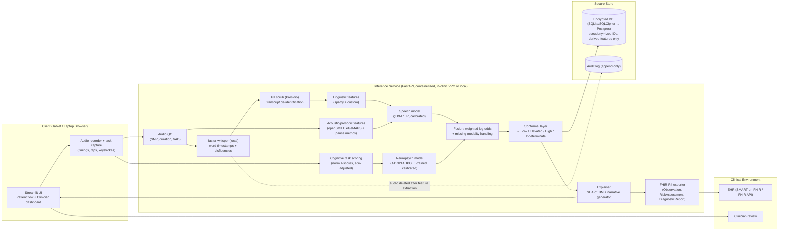
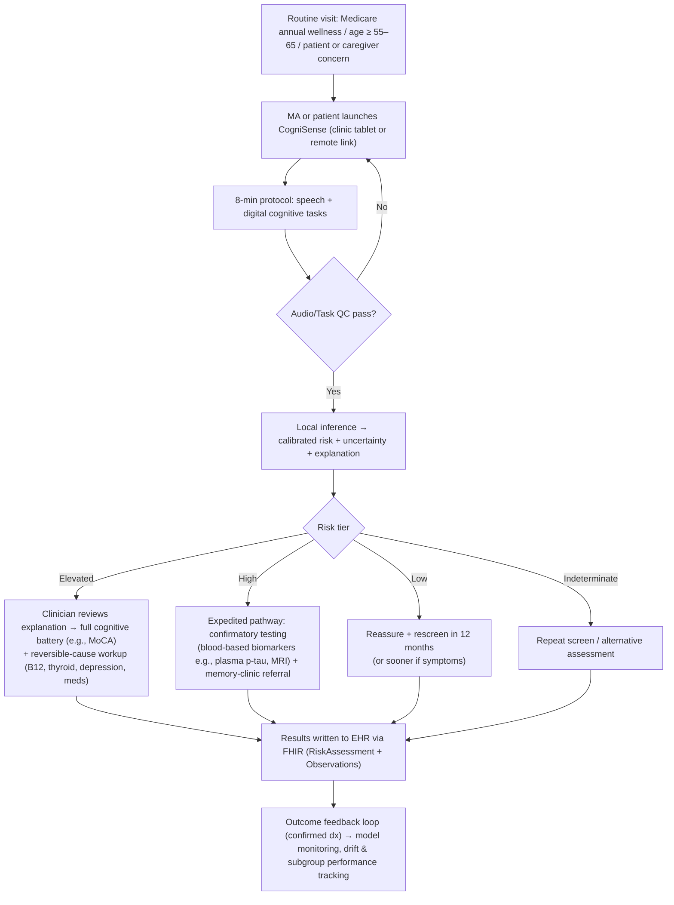

# CogniSense — Multimodal Digital Biomarker Screening for Early Alzheimer's / MCI
### Implementation Plan (Hackathon, Industry-Ready) — written for execution in Google Antigravity

> **Working title:** CogniSense — a sub-10-minute, explainable, fairness-audited cognitive screening pipeline that fuses **speech (acoustic + linguistic)** with **gamified digital neuropsychology**, outputs a **calibrated risk tier with uncertainty**, and plugs into primary-care workflows via **FHIR**.

---

## 0. How to Use This File in Antigravity

1. Open an empty workspace folder, drop this file at the repo root as `IMPLEMENTATION_PLAN.md`.
2. Copy **Section 0.1** into a workspace rule file (e.g. `AGENTS.md`, or your Antigravity workspace rules location such as `.agent/rules/`) so every agent session inherits the guardrails.
3. In the **Agent Manager**, start with **Phase 0** (single agent), then fan out to **parallel agents** per Section 17 (each agent owns a directory, so merges stay clean).
4. Each task in Section 16 has **explicit file paths and acceptance criteria**. Tell the agent: *"Implement Phase N tasks, run the acceptance checks, and produce a walkthrough artifact with screenshots/metrics before marking done."*
5. Never let an agent "finish" a phase without its acceptance checks passing.

### 0.1 Global Agent Rules (paste into workspace rules)

```
PROJECT: CogniSense (AD/MCI multimodal screening prototype)
RULES:
1. Python 3.11. Type hints + docstrings everywhere. Format with ruff + black. Tests with pytest.
2. NEVER commit raw datasets, audio, or transcripts from ADReSS/ADNI/DementiaBank. Only derived feature
   tables that the license allows, and ALWAYS .gitignore data/raw and data/interim.
3. Every random operation takes a seed (default 42). All experiments are reproducible via `make` targets.
4. NO DATA LEAKAGE: all splits are GROUPED BY SUBJECT. Never fit scalers/imputers/feature selectors outside
   the CV fold. Never use features that define the label (see Section 8.4).
5. Every model must be (a) calibrated, (b) explainable (SHAP/EBM), (c) evaluated per subgroup.
6. No external cloud API may receive audio or transcripts. ASR runs locally (faster-whisper).
7. UI copy must say "screening aid, not a diagnosis". Never display a diagnosis.
8. Every metric reported in README/UI must be generated by code in /reports and traceable to a commit.
9. Prefer simple, interpretable models over deep ones unless the gain is >0.02 AUROC with CI support.
10. Write small PRs/commits per task; update docs/CHANGELOG.md.
```

---

## 1. Executive Summary & Winning Thesis

**Problem:** AD pathology starts 15–20 years before symptoms; confirmatory tests (PET, MRI, CSF) are expensive/scarce, so most diagnoses are late.

**Our answer:** An *accessible triage layer* — not a diagnostic replacement — that any primary-care clinic (or patient at home) can run in **< 10 minutes** on a laptop/tablet, producing:
- A **risk tier** (Low / Elevated / High / Indeterminate) with a calibrated probability and confidence interval,
- A **clinician-readable explanation** (which speech/cognitive features drove the score, vs. normative reference),
- A **fairness-aware** result (education-adjusted, subgroup-audited),
- A **privacy-by-design** data path (audio never leaves the device/session; only derived features are stored),
- A **FHIR-ready export** and a defined **next-step pathway** (e.g., full cognitive battery → blood biomarker / specialist referral).

**What makes this stand out to judges (the differentiators):**

| Differentiator | Why it matters |
|---|---|
| **Honest, leakage-free evaluation** (subject-grouped CV, official ADReSS test split, bootstrap CIs, ASR-transcript evaluation, not just manual transcripts) | Most hackathon AD demos report inflated numbers. Credible metrics win technical judges. |
| **Glass-box models (EBM/logistic) + SHAP + clinician narrative** | Directly satisfies the XAI requirement with *clinically meaningful* features (pauses, idea density, recall) rather than opaque embeddings. |
| **Conformal "Indeterminate" tier + calibration** | Clinically safe: the system knows when it doesn't know. |
| **Fairness dashboard** (age, sex, education, language) + education-adjusted scoring | Directly addresses the bias requirement with evidence, not statements. |
| **Missing-modality-robust fusion** | Real clinics have noisy/partial data; the tool degrades gracefully. |
| **Privacy architecture + regulatory pathway (HIPAA/GDPR/SaMD)** | Shows industry readiness beyond the model. |
| **FHIR/SMART-on-FHIR integration design** | Shows it fits into actual clinical workflow. |

---

## 2. Requirements Traceability Matrix

| Hackathon requirement | Our solution component | Evidence we will show |
|---|---|---|
| Multimodal digital biomarkers | Speech (acoustic+linguistic) + digital neuropsych tasks (memory, fluency, processing speed/motor) | Fusion architecture + ablation table |
| Accessibility & speed (< 10 min) | Fixed 8-minute protocol (Section 4) with in-app timer | Live demo timed run |
| Explainability | EBM/SHAP feature contributions, normative z-scores, plain-language clinician report | Per-patient explanation panel |
| Bias & fairness | Subgroup metrics, education-adjusted norms, proxy-feature audit, thresholds analysis | Fairness report + dashboard tab |
| Data privacy (HIPAA/GDPR) | Local ASR, audio deletion, encryption, RBAC, audit log, DPIA-lite, de-identification | `docs/PRIVACY_AND_COMPLIANCE.md` + architecture |
| Working prototype | Streamlit app + FastAPI inference service + Docker | Live demo |
| Validation metrics (Sens/Spec/AUROC) on ADNI/TADPOLE/ADReSS | Reproducible evaluation pipeline | `reports/metrics.md` w/ CIs, ROC plots |
| Clinical integration workflow diagram | Mermaid + exported PNG; FHIR mapping | `docs/ARCHITECTURE.md` |

> **Note:** The original problem statement's last deliverable line (clinical integration workflow) was truncated in the prompt; this plan interprets it as "an architectural diagram showing how the tool fits into the clinical care pathway (intake → screening → clinician review → referral/EHR)". Adjust if the organizers' wording differs.

---

## 3. Scope Decisions (Be Ruthless)

**In scope (P0 — must work in demo):**
1. Speech pipeline on Cookie Theft–style picture description: ASR → linguistic + acoustic features → AD-vs-control classifier.
2. Digital cognitive module (3 short tasks): word-list recall (immediate + delayed), animal fluency, trail-making-lite (processing speed/executive).
3. Tabular neuropsych model trained on ADNI/TADPOLE (CN vs MCI) using **non-label-defining** features that map to our digital tasks.
4. Late fusion + calibration + conformal uncertainty → risk tier.
5. XAI report, fairness report, privacy design, FHIR export, Streamlit UI, FastAPI backend, Docker.

**P1 (if time allows):** Bilingual/multilingual evaluation (e.g., TAUKADIAL English/Mandarin if access granted), keystroke/tap-timing exploratory features, PDF report export, wav2vec2/HuBERT embedding challenger model, longitudinal-trend view (mock).

**P2 / Roadmap only (document, don't build):** Retinal fundus & eye-tracking models, gait/wearable, federated learning, on-device (WASM/mobile) inference, prospective clinical validation.

**Explicit non-goals:** No diagnosis claims; no use of genetics (APOE) in the default model (sensitive and ethically fraught for a screener); no claims of clinical validity.

---

## 4. Product Design: The 8-Minute Protocol

| # | Step | Modality | Duration | Captured signal |
|---|---|---|---|---|
| 0 | Consent + demographics (age, sex, years of education, primary language) | — | 1:00 | Needed for normative adjustment + fairness audit (stored separately, minimal) |
| 1 | **Picture description** (Cookie Theft–style image; *use a team-made/licensed look-alike scene in the demo; the original is from the Boston Diagnostic Aphasia Examination*) | Speech | 1:30–2:00 | Audio → transcript, pauses, rate, lexical/syntactic/semantic features |
| 2 | **Word-list encoding** (10 words shown/read, 3 trials compressed to 2 for speed) | Episodic memory | 1:00 | Immediate recall (RAVLT-like) |
| 3 | **Animal fluency** (60 s, spoken or typed) | Semantic/executive | 1:00 | Count, clustering/switching, intrusion/repetition |
| 4 | **Trail-making-lite** (tap numbers 1→A→2→B… on screen) | Processing speed / executive / fine motor | 1:30 | Completion time, errors, inter-tap interval variability |
| 5 | **Delayed recall** of the word list (natural delay ≈ 4–5 min after encoding, filled by steps 3–4) | Episodic memory | 0:45 | Delayed recall, forgetting rate |
| 6 | Results screen / clinician report | — | — | — |
| **Total** | | | **≈ 7:30–8:15** | |

Design notes:
- Step ordering uses steps 3–4 as the delay interval for step 5 (efficient + standard practice).
- Provide **practice trials** and large-font, high-contrast UI (accessibility; WCAG 2.1 AA targets).
- Support **tablet touch and mouse**; record **device type** as metadata (domain-shift control).
- Include **audio quality check** (SNR/clipping/min-duration gate) with retry prompt — essential for real-world robustness.
- Language: English for P0; architect prompts/lexicons as i18n resources for future languages.

---

## 5. Architecture

### 5.1 System Architecture



### 5.2 Clinical Integration Workflow (the deliverable diagram)



### 5.3 Fusion Design (read carefully — this is where hackathon solutions usually cheat)

**The data reality:** ADReSS (speech) and ADNI/TADPOLE (neuropsych) are **different cohorts — there is no subject-level pairing.** Therefore we **cannot honestly train a joint end-to-end multimodal model.** We do this instead:

1. Train **independent, calibrated, modality-specific models** on the best public dataset for each modality.
2. Combine with a **transparent naive-Bayes-style late fusion** (sum of calibrated log-likelihood ratios), with a **shrinkage weight** to hedge against modality dependence:

```
logit(P_fused) = logit(prior_pop) + Σ_m  w_m · [ logit(p_m) − logit(prior_train_m) ]
w_m ∈ (0, 1]   (default 0.7; chosen conservatively; sensitivity analysis reported)
prior_pop       = age-stratified prevalence prior (documented, configurable by clinic)
prior_train_m   = class prior in modality m's training data (0.5 for balanced ADReSS)
```
3. **Missing modality:** the sum simply skips unavailable terms; UI shows "based on 1 of 2 modalities" and widens uncertainty.
4. **State the assumption in the UI/README:** *conditional independence given class is assumed; validated only per-modality; joint validation requires a prospective paired cohort (roadmap).* This candor is a strength.
5. **Synthetic paired demo cohort:** for the UI demo only, create paired "patients" by sampling feature vectors from the held-out sets of each modality's cohort by label. **Label it clearly as "demo-only synthetic pairing"** and never use it for reported performance.

**Digital-task ↔ ADNI-feature mapping (makes the neuropsych model transferable):**

| Digital task | ADNI/TADPOLE analogue (verify exact column names in your download) |
|---|---|
| Word-list immediate/delayed recall, % forgetting | RAVLT immediate, learning, delayed, percent forgetting |
| Animal fluency (count) | Category fluency – animals (neuropsych battery table) |
| Trail-making-lite completion time | Trails B time (and Trails A if available) |
| Demographics | Age, sex, years of education |

**Known limitation to state explicitly:** digital versions ≠ paper tests; score distributions shift. Mitigation: z-score alignment to published norms and a *planned* concordance study. Mark the neuropsych model's output "research-grade pending digital-paper concordance validation".

---

## 6. Tech Stack

| Layer | Choice | Rationale |
|---|---|---|
| Language | Python 3.11 | ML ecosystem |
| ASR | `faster-whisper` (`small.en` default; `medium` optional) | Local, fast, word timestamps; keeps audio on-prem |
| Disfluency retention | Whisper with a disfluency-priming `initial_prompt` (e.g., "Umm, let me think like, hmm... okay, so, uh, I see a…") | Whisper tends to drop fillers; fillers are a signal |
| VAD / pauses | `silero-vad` + word-timestamp gaps | Pause statistics |
| Acoustic | `opensmile` (eGeMAPSv02 functionals) | Standard, interpretable prosody/voice set |
| NLP | `spaCy` (`en_core_web_md` or `_trf`), `nltk`, `textstat`, `lexicalrichness` | Lexical diversity, syntax, readability |
| De-ID | `presidio-analyzer` / `presidio-anonymizer` | PII scrubbing of transcripts |
| ML | `scikit-learn`, `interpret` (EBM), `lightgbm`, `shap` | Glass-box + challenger |
| Calibration/UQ | sklearn `CalibratedClassifierCV`, `mapie` (conformal) | Safe probabilities + abstention |
| Fairness | `fairlearn` + custom plots | Subgroup metrics, equalized odds gaps |
| Backend | `FastAPI` + `pydantic` v2 + `uvicorn` | Typed API, auto OpenAPI docs |
| Frontend | `Streamlit` (≥1.39 for `st.audio_input`) + `plotly` | Fastest path to a polished demo |
| Interop | `fhir.resources` | FHIR R4 resource generation |
| Storage | SQLite (SQLCipher or app-level AES-GCM) → Postgres in prod | Simple demo; upgrade path |
| Packaging | Docker + docker-compose, Makefile | Reproducible |
| Quality | `pytest`, `ruff`, `black`, `pre-commit`, GitHub Actions | Industry hygiene |
| Experiment tracking | Plain `reports/*.json` + `mlflow` (optional) | Traceable metrics |

---

## 7. Repository Structure

```
cognisense/
├── IMPLEMENTATION_PLAN.md
├── AGENTS.md                      # Section 0.1 rules
├── README.md                      # judge-facing: problem → solution → results → demo GIF
├── Makefile                       # make setup | data | features | train | evaluate | fairness | app | test
├── pyproject.toml
├── docker-compose.yml
├── .gitignore                     # data/raw, data/interim, *.wav, *.mp3, models/*.bin (large)
├── configs/
│   ├── default.yaml               # seeds, thresholds, weights w_m, paths
│   └── protocol.yaml              # task order, durations, prompts
├── data/
│   ├── raw/                       # NEVER COMMITTED (ADReSS, ADNI, ...)
│   ├── interim/                   # NEVER COMMITTED (transcripts, ASR output)
│   ├── processed/                 # derived feature tables (commit only if license allows)
│   └── demo/                      # team-recorded / synthetic demo cases (safe to commit)
├── src/cognisense/
│   ├── data/                      # loaders, splits (subject-grouped), schema validation
│   ├── speech/
│   │   ├── asr.py                 # faster-whisper wrapper (+ disfluency priming)
│   │   ├── qc.py                  # SNR, clipping, duration, VAD
│   │   ├── acoustic.py            # openSMILE + pause/rate features
│   │   ├── linguistic.py          # lexical, syntactic, semantic, info-unit coverage
│   │   └── deid.py                # Presidio scrubbing
│   ├── cognitive/
│   │   ├── tasks.py               # task scoring (recall, fluency, trails)
│   │   ├── norms.py               # normative z-scores, education adjustment
│   │   └── fluency_analysis.py    # clustering/switching, repetitions
│   ├── models/
│   │   ├── speech_model.py
│   │   ├── neuropsych_model.py
│   │   ├── calibration.py
│   │   ├── conformal.py
│   │   ├── fusion.py
│   │   └── registry.py            # versioned artifacts + model cards
│   ├── explain/
│   │   ├── shap_utils.py
│   │   ├── narrative.py           # features → clinician-readable sentences
│   │   └── report.py              # HTML/PDF report
│   ├── fairness/
│   │   ├── subgroup_metrics.py
│   │   ├── proxy_audit.py         # can features predict education/sex/age?
│   │   └── plots.py
│   ├── privacy/
│   │   ├── crypto.py              # AES-GCM field encryption
│   │   ├── audit.py               # append-only audit log
│   │   ├── retention.py           # audio TTL / deletion
│   │   └── pseudonym.py
│   ├── interop/fhir.py
│   └── api/                       # FastAPI app, routers, schemas
├── app/                           # Streamlit pages
│   ├── Home.py
│   ├── pages/1_Patient_Assessment.py
│   ├── pages/2_Clinician_Dashboard.py
│   ├── pages/3_Model_Performance.py
│   ├── pages/4_Fairness_Audit.py
│   └── pages/5_Privacy_and_Compliance.py
├── notebooks/                     # EDA + reproducible walkthrough (01_speech, 02_neuropsych, 03_fusion)
├── reports/                       # generated metrics, ROC/calibration plots, fairness tables
├── docs/
│   ├── ARCHITECTURE.md            # diagrams exported
│   ├── MODEL_CARD.md
│   ├── DATASHEET.md
│   ├── FAIRNESS_REPORT.md
│   ├── PRIVACY_AND_COMPLIANCE.md
│   ├── CLINICAL_WORKFLOW.md
│   └── DEMO_SCRIPT.md
└── tests/
```

---

## 8. Data Strategy

### 8.1 Datasets and Access (START ACCESS REQUESTS ON HOUR 0 — approvals can take days)

| Dataset | Use | Access | Notes |
|---|---|---|---|
| **ADReSS / ADReSSo** (DementiaBank, Pitt Cookie Theft) | Speech model: AD vs. control | Requires DementiaBank membership/agreement (TalkBank) | ADReSS: age/sex/balanced, audio + manual transcripts, standard train/test. ADReSSo: audio only (the realistic deployment scenario). **Check the current sizes/license on the DementiaBank site.** |
| **ADNI → ADNIMERGE / TADPOLE** | Neuropsych model: CN vs. MCI | ADNI data-use application (can take days) | TADPOLE is derived from ADNI — follow the challenge instructions. Don't redistribute. |
| **TAUKADIAL (Interspeech 2024)** *(optional, P1)* | Bilingual (English/Chinese) MCI speech, fairness across language | Via organizers/DementiaBank | If obtainable, it gives a real cross-language fairness story. |
| **OASIS / NACC** *(optional)* | External validation of neuropsych model | Registration/request | Only if time. |

### 8.2 Fallback Plan if Access Is Delayed (don't stall the build)
- Build all pipelines against a **synthetic data generator** (`src/cognisense/data/synthetic.py`) that mimics feature schemas, so UI/API/fusion/privacy/fairness code is developed in parallel.
- Use **team-recorded demo audio** for end-to-end demos (consented, non-clinical, clearly labelled).
- Any metrics computed on synthetic data must be labelled **"SYNTHETIC — pipeline test only"** in every artifact. **Never present them as validation results.**
- Swap in real data when approved; the pipeline must be config-driven (`configs/default.yaml`) so this is a one-line change.

### 8.3 Splits and Leakage Control
- **Group by subject always.** (In full Pitt data there are multiple recordings per speaker → naive splits leak speaker identity. ADReSS avoids this, but code must enforce it.)
- Evaluation protocol:
  1. **Repeated stratified, subject-grouped K-fold CV** (e.g., 5×5 or 10-fold) on the training portion for model selection.
  2. **Official ADReSS test partition used ONCE** at the end for the headline number (cohort is small — report CIs).
  3. **ADReSSo audio-only → ASR transcripts** to quantify the realistic ASR degradation gap vs. manual transcripts.
- Fit scalers/imputers/feature selection **inside** each fold via sklearn `Pipeline`.
- Threshold selection happens on training folds only (not on test).

### 8.4 Label-Leakage Guard for ADNI/TADPOLE (important and often missed)
ADNI's MCI/AD labels are *defined* using certain instruments (e.g., MMSE range, CDR, Logical Memory delayed recall, ADAS-Cog/FAQ are strongly tied to staging). Using them to "predict" MCI is circular.
- **EXCLUDE** from the screening model: `CDR*`, `MMSE`, `MOCA`, `ADAS*`, `FAQ`, `LDELTOTAL` (Logical Memory delayed), diagnosis-derived fields, imaging, CSF, PET, APOE.
- **INCLUDE** only features that have analogues in our digital protocol (Section 5.3) + demographics.
- Add an automated test (`tests/test_no_leakage.py`) that fails if any banned column enters the feature matrix.
- Report a secondary, clearly labelled "upper-bound" analysis (with MMSE/MoCA etc.) only if desired, to show the circularity effect — optional.

### 8.5 Target Definitions
- Speech model: **AD vs. cognitively normal (CN)** (ADReSS binary).
- Neuropsych model: **CN vs. MCI** primary (the screening target); **CN vs. MCI+AD** secondary.
- Product-level label: **"cognitive impairment likely (MCI/AD-spectrum)"**, never "Alzheimer's".

---

## 9. ML Pipeline Detail

### 9.1 Speech Pipeline

**Step 1 – QC (`speech/qc.py`):** reject/retry if duration < 45 s, clipping > 1%, estimated SNR < ~15 dB, or speech ratio < threshold.

**Step 2 – ASR (`speech/asr.py`):** `faster-whisper` with word timestamps, VAD filter off for the disfluency pass (or tuned), disfluency-priming prompt, `temperature=0`, fixed beam size. Store: transcript, per-word start/end/confidence. **Delete audio after feature extraction** (configurable TTL; default immediate).

**Step 3 – De-identification (`speech/deid.py`):** Presidio on transcript before persistence (names, locations, dates, phone numbers).

**Step 4 – Features**

*Acoustic/prosodic (explainable, ~30–100 features):*
- Pause metrics from word gaps/VAD: pause count/min, mean/median/max pause, % time in pause, pauses > 250 ms, > 1 s; pause-before-content-word vs. function-word (hesitation location).
- Rate: words/min, articulation rate (excl. pauses), phonation time ratio.
- eGeMAPSv02 functionals (88 features): F0 mean/variability, jitter/shimmer, HNR, formants, loudness, spectral slope, MFCC stats. Use subsets + regularization.

*Linguistic:*
- **Lexical:** type–token ratio, MATTR, Brunét's W, Honoré's statistic, word-frequency (mean log-frequency), proportion of nouns/verbs/pronouns/adjectives, **pronoun-to-noun ratio**, % function words, vague/indefinite words ("thing", "stuff").
- **Disfluency:** fillers (uh/um) per 100 words, repetitions, false starts, revisions (from transcript patterns).
- **Syntactic:** mean utterance length, parse-tree depth, clauses per utterance, subordination ratio, fragment ratio.
- **Semantic/content:** **Information-unit coverage** for the Cookie Theft scene (curated lexicon of ~25 content units: boy, stool, falling, cookie jar, mother/woman, sink, overflowing water, dishes, window, curtains, girl, etc.), idea density (propositional density approximation), semantic coherence (mean cosine similarity between consecutive sentence embeddings), off-topic ratio.
- **Optional embeddings (challenger only):** sentence-transformer / DistilBERT embedding + LR, wav2vec2/HuBERT mean-pooled embeddings. Compare to handcrafted; keep embeddings out of the explainable primary model unless gain is significant and explainable (e.g., via feature attribution at token level).

**Step 5 – Models (`models/speech_model.py`):**
1. **Primary:** Explainable Boosting Machine (`interpret.glassbox.ExplainableBoostingClassifier`) *or* elastic-net logistic regression on standardized features. Both are glass-box → exact per-feature contributions.
2. **Challenger:** LightGBM + SHAP; embeddings + LR.
3. **Feature selection:** inside CV (L1/stability selection) → keep ≤ ~20–30 features for stability given small n (ADReSS ≈ 108 train subjects). **Beware overfitting:** small-sample regime; prefer strong regularization, report CV variance.
4. **Calibration:** isotonic is risky at n≈100 → prefer **Platt/sigmoid or temperature scaling** with nested CV; report ECE + Brier + reliability diagram.

### 9.2 Cognitive/Neuropsych Pipeline
- **Digital scoring (`cognitive/tasks.py`):** immediate recall (0–10), delayed recall (0–10), % forgetting, animal count (60 s), repetitions/intrusions, trail completion time, error count, inter-tap-interval CV.
- **Norm adjustment (`cognitive/norms.py`):** convert to z-scores using published normative regressions where available (age, education, sex) — **document the source for each norm and mark any placeholder as "illustrative"**. Education adjustment is the key bias-mitigation lever for cognitive tests.
- **Model (`models/neuropsych_model.py`):** trained on ADNI/TADPOLE neuropsych features (Section 8.4) → logistic regression / EBM; calibrated; handles missing values with **in-fold** imputation + missingness indicators.
- **Fluency analysis:** semantic cluster size and switches (animal subcategories lexicon: pets, farm, African, birds, aquatic, …), perseverations.

### 9.3 Fusion → Risk Tier
1. Convert each modality's calibrated probability to log-odds; fuse (Section 5.3).
2. **Conformal prediction (`models/conformal.py`, `mapie`)**: split/CV+ conformal on calibration folds → produce prediction sets. Map:
   - Set = {impaired} → **High**
   - Set = {normal} → **Low**
   - Set = {both} → **Indeterminate** (repeat / clinician judgment)
   - **Elevated** = fused probability between a *screening* threshold (high-sensitivity operating point) and the High threshold.
3. **Operating point:** screening ⇒ prioritize sensitivity. Choose the threshold on training folds to hit **≥ 90% sensitivity**, then report the resulting specificity honestly (expect modest specificity; that is the nature of triage — pair with a confirmatory pathway). Provide a **threshold slider in the clinician UI** showing the sensitivity/specificity/PPV trade-off at user-set **prevalence** (PPV in a primary-care population is much lower than in a balanced research cohort — **show this explicitly**; it's an honesty point judges notice).

### 9.4 Reproducibility
- `make train` → trains models with fixed seeds, saves artifacts to `models/` with a JSON sidecar (git commit hash, data version hash, config, metrics).
- `make evaluate` → writes `reports/metrics.json`, `reports/metrics.md`, ROC/PR/calibration PNGs.

---

## 10. Explainability (XAI) Spec

Three layers of explanation, all surfaced in the clinician dashboard:

1. **Global:** EBM/LR feature importance + partial-dependence shape plots ("how risk changes with pause rate").
2. **Local (per patient):** top ±5 feature contributions (waterfall chart) with **patient value vs. reference-range value** (e.g., "Pause time: 38% vs. typical 22%").
3. **Narrative (`explain/narrative.py`):** deterministic templates map top contributions to clinician-friendly sentences. Example:
   > *"Elevated risk driven by: (1) longer and more frequent pauses before content words (↑ hesitation), (2) lower coverage of key scene elements (11/25), (3) reduced delayed word recall (2/10, ~−1.6 SD for age and education). Speech modality: ↑; Cognitive modality: ↑. Confidence: moderate (interval 0.41–0.78)."*

Guardrails:
- Templates are deterministic (no LLM-generated clinical text → no hallucination risk). An LLM may optionally paraphrase for tone **only if it runs locally** and the numbers are injected verbatim; default OFF.
- Always display: modalities used, data-quality flags, uncertainty interval, "screening aid, not a diagnosis."
- **Sanity checks:** run SHAP/EBM stability across CV folds (rank correlation of importances) and report it — unstable explanations are a red flag.

---

## 11. Bias & Fairness Plan

**Demographic strata to audit:** age band (e.g., <65, 65–74, ≥75), sex, education (≤12 yrs vs. >12 yrs), language/L1 (English vs. other if TAUKADIAL or accented-speech subsets available), device type (tablet/laptop/mic quality).

**Metrics per subgroup:** AUROC, sensitivity, specificity at the fixed operating point, FPR/TPR gaps (equalized-odds difference), calibration (ECE) per group, indeterminate-rate per group (abstention shouldn't disproportionately affect one group).

**Mitigations (documented and measured, not just listed):**
1. **Education-adjusted normative scoring** for cognitive tasks (primary lever).
2. **Remove/neutralize demographic proxies:** `proxy_audit.py` trains a probe to predict education/sex/age from model features; if predictable with high AUROC and these also drive predictions, drop/regularize/decorrelate those features.
3. **Group-aware evaluation of thresholds:** if a single threshold yields a sensitivity gap > 5–10 points, evaluate group-specific *adjustment via covariate-adjusted features* (preferred) vs. group-specific thresholds (flag ethical/regulatory implications before use).
4. **Reweighting / stratified sampling** during training to balance subgroup representation where counts allow.
5. **Sensitivity of results to ASR WER** by accent/demographic (if data permits): compute WER stratified by group — ASR error is a hidden bias channel.

**Honest limitations to publish (`docs/FAIRNESS_REPORT.md`):** public speech benchmarks are small, English-centric, and demographically narrow; subgroup n is small → wide CIs; no claims of equity beyond what the data supports; proposed prospective multi-site, multilingual validation.

---

## 12. Privacy, Security, Compliance

**Principles:** data minimization, local processing, purpose limitation, privacy by design.

| Control | Implementation |
|---|---|
| **Audio handling** | Processed in-memory/ephemeral temp storage; deleted immediately after feature extraction (config TTL ≤ session). Only derived features + de-identified transcript hash/features persisted by default. |
| **No third-party AI APIs** | ASR/NLP run locally; zero audio/transcript egress. |
| **Pseudonymization** | Random subject UUID; identity-linkage table stored separately (clinic-side), not in the analytics store. |
| **Encryption** | TLS 1.2+/1.3 in transit; AES-256-GCM for sensitive fields at rest; keys from env/secret manager (never in repo). |
| **Access control** | Role-based (patient / MA / clinician / admin); clinician-only access to reports. |
| **Audit logging** | Append-only log of access, exports, deletions (who/what/when). |
| **Consent** | Explicit, granular consent screen (screening use; optional research use); consent record stored with timestamp/version. |
| **Data subject rights (GDPR)** | Delete-my-data endpoint (erasure), export endpoint (portability), retention policy; lawful basis documented (explicit consent for special-category health data, Art. 9). |
| **HIPAA** | Safeguards mapping (administrative/physical/technical); BAA required with any cloud/hosting vendor; minimum-necessary principle; breach-notification runbook (documented). |
| **De-identification** | Presidio scrubbing of transcripts; Safe Harbor identifiers removed from any exported dataset. |
| **DPIA-lite** | `docs/PRIVACY_AND_COMPLIANCE.md` with data-flow table, risks, mitigations. |
| **Model privacy** | Roadmap: federated learning across clinics + differential privacy; model-inversion risk noted. |
| **Regulatory pathway** | Intended use = screening aid; likely **SaMD** (FDA De Novo/510(k) pathway, EU MDR class IIa or higher, IEC 62304, ISO 14971 risk management, ISO 13485 QMS, clinical validation prospectively). Document, don't claim. |
| **Demo data** | Only consented team-recorded/synthetic audio in the repo. |

> Disclaimer in docs: *"This is a research prototype, not a medical device; not HIPAA/GDPR certified; compliance mapping is a design intent."* Do not claim compliance — claim *design alignment*.

---

## 13. Evaluation & Metrics Plan

**Reported for every model and the fusion (with 95% bootstrap CIs, ≥1000 resamples):**
AUROC, AUPRC, **Sensitivity @ fixed operating point**, **Specificity**, PPV/NPV at **clinic-realistic prevalence (e.g., 10–15%)** in addition to balanced prevalence, F1, Brier score, ECE, indeterminate-rate, subgroup tables.

**Required experiments (build a table for the pitch):**

| Experiment | Purpose |
|---|---|
| Acoustic-only vs. Linguistic-only vs. Speech-combined | Show what each stream contributes |
| Manual transcript vs. Whisper ASR transcript | Real-world degradation |
| With/without disfluency priming in ASR | Justify design choice |
| EBM vs. LR vs. LightGBM vs. embeddings | Justify "glass-box is enough" (or not) |
| Neuropsych model: CN vs. MCI (ADNI/TADPOLE, subject-grouped CV) | Cognitive-stream validity |
| Fusion vs. single-modality (on demo-only synthetic pairing — labelled; plus fusion weight sensitivity) | Show mechanism; avoid over-claiming |
| Fairness subgroup tables | Equity evidence |
| Calibration (reliability diagrams) before/after | Safe risk probabilities |
| Robustness: add noise/low-bitrate to audio, shorten recordings | Real-world stress test |

**Target ranges (aspirational; report whatever you truly get):**
- Speech model on ADReSS: AUROC ≈ 0.80–0.90 (published challenge baselines/approaches cluster in roughly the 70s–high-80s % accuracy; with n≈100 treat anything higher than ~0.92 with suspicion → check leakage).
- Neuropsych CN vs. MCI (non-defining features): AUROC ≈ 0.75–0.88.
- **Sensitivity ≥ 0.85–0.90 at a documented specificity.**
- **Red flag rule:** if AUROC > 0.95 on small data, **assume leakage until proven otherwise** and audit.

---

## 14. App Specification (Streamlit)

**Page 1 – Patient Assessment** (stepper UI, large type, progress bar + 8-min timer): consent → demographics → tasks (Section 4) → "Processing…" → thank-you screen (patient sees *no* risk score by default; results go to clinician — configurable).

**Page 2 – Clinician Dashboard (hero page):**
- Risk tier badge (color + icon + text, accessible), calibrated probability + CI, modalities used, QC flags.
- **Explanation panel:** waterfall of top features, patient-vs-reference bars, narrative paragraph.
- **Radar/bar of cognitive domains** (memory, language/fluency, processing speed, speech fluency) as z-scores vs. education/age-adjusted norms.
- **Threshold & prevalence slider** → live sensitivity/specificity/PPV/NPV.
- Recommended next step (from the workflow) + **"Export FHIR bundle"** + **"Download PDF report"**.
- Demo selector: pre-loaded personas (e.g., "Low risk", "Elevated – memory", "High – speech+memory", "Indeterminate – poor audio").

**Page 3 – Model Performance:** ROC, PR, calibration plots; metrics table with CIs; ablation table; ASR-vs-manual gap.

**Page 4 – Fairness Audit:** subgroup metric table, TPR/FPR gap charts, indeterminate-rate by group, limitations text.

**Page 5 – Privacy & Compliance:** live data-flow diagram, what is stored vs. deleted, retention timer, consent log, "delete my data" button, compliance alignment table.

UX requirements: WCAG-minded contrast, keyboard navigation, i18n-ready strings, graceful error states (mic denied, low audio quality), responsive for tablets.

---

## 15. API Spec (FastAPI)

| Endpoint | Method | Purpose |
|---|---|---|
| `/v1/sessions` | POST | Create pseudonymized session + consent record |
| `/v1/sessions/{id}/speech` | POST (multipart audio) | QC → ASR → features → speech score (audio deleted after) |
| `/v1/sessions/{id}/cognitive` | POST (JSON task results) | Score tasks → norm z-scores → neuropsych score |
| `/v1/sessions/{id}/result` | GET | Fused risk, tier, CI, explanation, flags |
| `/v1/sessions/{id}/report` | GET | HTML/PDF clinician report |
| `/v1/sessions/{id}/fhir` | GET | FHIR R4 Bundle |
| `/v1/sessions/{id}` | DELETE | Erasure (GDPR) |
| `/v1/model/card` | GET | Model card/version/metrics |
| `/healthz` | GET | Liveness |

Result schema (pydantic) sketch:

```python
class ModalityResult(BaseModel):
    name: Literal["speech", "cognitive"]
    probability: float            # calibrated
    available: bool
    qc_flags: list[str]
    top_contributions: list[FeatureContribution]  # name, value, reference, shap, direction

class RiskResult(BaseModel):
    session_id: str
    fused_probability: float
    ci_low: float
    ci_high: float
    tier: Literal["low", "elevated", "high", "indeterminate"]
    modalities: list[ModalityResult]
    narrative: str
    recommended_action: str
    model_version: str
    disclaimer: str = "Screening aid, not a diagnosis."
```

**FHIR mapping:** `Patient` (pseudonymized), `Observation` per cognitive score (LOINC where applicable, else local code system), `Observation` for speech-derived indices, `RiskAssessment` (probability + qualitative risk + basis → Observations), `DiagnosticReport` (narrative + PDF as `Attachment`), `Provenance` (model version, software). Provide **SMART-on-FHIR launch** as a documented roadmap step; export bundle is the P0 deliverable.

---

## 16. Phased Task Plan (Execute in Order; Acceptance Criteria Included)

> Time estimates assume a ~36–48 hour hackathon with 2–4 parallel agents + 1–2 humans. Compress/expand proportionally.

### Phase 0 — Foundation (Hours 0–2) *[single agent]*
**Human actions (hour 0):** submit DementiaBank/ADReSS and ADNI access requests; confirm hackathon rules on data usage.
**Tasks:**
- [ ] Scaffold repo structure (Section 7), `pyproject.toml`, Makefile, pre-commit, `.gitignore` (data/audio excluded), `AGENTS.md`.
- [ ] `configs/default.yaml` (seed=42, paths, fusion weights, thresholds).
- [ ] CI workflow (lint + tests).
- [ ] Synthetic data generator + schema (pydantic/pandera) so downstream work is unblocked.
**Acceptance:** `make setup && make test` passes; `docker compose build` works; synthetic data generated.

### Phase 1 — Speech Pipeline (Hours 2–12) *[Agent A]*
- [ ] `speech/qc.py`, `asr.py` (priming prompt, word timestamps), `deid.py`.
- [ ] `acoustic.py` (pauses/rate + eGeMAPS), `linguistic.py` (features in 9.1, info-unit lexicon in `configs/cookie_theft_units.yaml`).
- [ ] Feature table builder: `make features` → `data/processed/speech_features.parquet`.
- [ ] Models: LR + EBM + LightGBM, subject-grouped CV, nested calibration, fixed-sensitivity threshold.
- [ ] Evaluate manual-vs-ASR transcripts.
**Acceptance:** `make evaluate-speech` outputs metrics.json with CIs; unit tests for each feature extractor (known toy inputs → known outputs); `tests/test_no_leakage.py` passes; per-feature explanation JSON produced for 1 sample.

### Phase 2 — Neuropsych + Cognitive Tasks (Hours 2–12) *[Agent B, parallel]*
- [ ] ADNI/TADPOLE loader, banned-column guard, feature mapping (Section 5.3/8.4).
- [ ] Neuropsych model (LR/EBM), in-fold imputation, calibration, CN-vs-MCI metrics.
- [ ] `cognitive/tasks.py`, `norms.py` (with cited sources/placeholder labels), `fluency_analysis.py`.
- [ ] Browser-side task components spec (timings, taps) feeding the API schema.
**Acceptance:** metrics.json for neuropsych model; test proving banned columns can't enter; task scoring unit tests (edge cases: zero recall, repetitions, timeouts).

### Phase 3 — Fusion, Uncertainty, XAI (Hours 12–20) *[Agent A or C]*
- [ ] `fusion.py` (Section 5.3), missing-modality tests, sensitivity analysis on `w_m`.
- [ ] `conformal.py` + tier mapping; indeterminate-rate reporting.
- [ ] `explain/` (SHAP/EBM utilities, narrative templates, report HTML).
- [ ] Explanation stability check across folds.
**Acceptance:** `fuse(speech=None, cognitive=0.7)` works; tier logic unit-tested at boundaries; narrative generated for 4 personas; explanation stability metric in reports.

### Phase 4 — Fairness & Privacy (Hours 12–22) *[Agent D, parallel with 3]*
- [ ] `fairness/` modules + `reports/fairness_*.md/png`.
- [ ] `privacy/` modules (crypto, audit, retention, pseudonym) + tests (audio file absent after processing; erasure deletes all records; audit log append-only).
- [ ] Docs: FAIRNESS_REPORT, PRIVACY_AND_COMPLIANCE, DATASHEET, MODEL_CARD (templates in Appendix C).
**Acceptance:** subgroup tables generated from real or clearly-labelled synthetic data; privacy tests green; docs reference actual numbers produced by code.

### Phase 5 — API + App (Hours 16–30) *[Agent C]*
- [ ] FastAPI per Section 15 with pydantic schemas, OpenAPI docs.
- [ ] Streamlit pages 1–5 (Section 14), demo personas, PDF/FHIR export.
- [ ] `docker-compose up` brings up API + app.
**Acceptance:** full run-through of the 8-minute protocol on a laptop in < 10 min; end-to-end test (`tests/test_e2e.py`) posts sample audio + task JSON and receives a valid `RiskResult`; FHIR bundle validates against `fhir.resources` models.

### Phase 6 — Hardening & Polish (Hours 30–38)
- [ ] Robustness tests (noisy audio, short audio, mic missing); latency profiling (target: result < 20 s after last task on CPU with `small.en`).
- [ ] README with hero GIF, results table, architecture diagrams exported to PNG/SVG.
- [ ] Pre-compute and cache demo results; offline-capable demo.
**Acceptance:** cold-start demo works without internet; no secrets in repo; `make all` reproduces reported numbers.

### Phase 7 — Pitch Prep (Hours 38–44)
- [ ] 3-minute demo script (Section 19) rehearsed twice; backup screen recording.
- [ ] 5–7 slide deck: problem → insight → solution → live demo → validation → fairness/privacy → roadmap/impact.
- [ ] Q&A prep sheet (Section 19.3).

---

## 17. Parallel Agent Assignment (Antigravity Agent Manager)

| Agent | Owns (directories) | Starts after | Handoff artifact |
|---|---|---|---|
| **Agent 0 – Scaffolder** | repo root, `configs/`, CI | — | Working skeleton + synthetic data |
| **Agent A – Speech ML** | `src/cognisense/speech/`, `models/speech_model.py`, `notebooks/01_*` | Phase 0 | `speech_features.parquet`, speech model + metrics |
| **Agent B – Cognitive/Neuropsych ML** | `src/cognisense/cognitive/`, `models/neuropsych_model.py`, `notebooks/02_*` | Phase 0 | Neuropsych model + task-scoring API |
| **Agent C – App/API** | `src/cognisense/api/`, `app/`, `interop/` | Phase 0 (uses synthetic/mocked models until A/B land) | Running demo app |
| **Agent D – Trust (Fairness/Privacy/Docs)** | `fairness/`, `privacy/`, `docs/`, `explain/` | Phase 0 | Reports + docs + tests |
| **Browser/QA agent** (Antigravity's browser capability, if available) | `tests/e2e`, screenshots | Phase 5 | Walkthrough artifact w/ recordings of the full patient flow |

Rules: interfaces first — Agent 0 defines `pydantic` schemas in `src/cognisense/schemas.py` so A/B/C/D can work against mocks. Merge frequently; each agent writes a **walkthrough artifact** summarizing what changed, tests passed, and metrics.

---

## 18. Testing & Quality

- **Unit:** feature extractors (toy sentences with known TTR/pronoun ratios; synthetic audio with known silences for pause metrics), task scoring, norms, fusion math, conformal tiers.
- **Property tests:** fused probability monotonic in each modality's probability; fused ≈ prior when no modality available (UI shows "insufficient data").
- **Leakage tests:** subject overlap between train/val is empty; banned columns absent.
- **Privacy tests:** raw audio not on disk after processing; transcripts de-identified; erasure complete; audit entries written.
- **Fairness regression test:** CI fails if subgroup sensitivity gap exceeds a configured bound on the reference dataset (or flags warning in hackathon mode).
- **E2E:** scripted run through API with demo audio.
- **Performance:** latency budget; memory budget for CPU-only laptop.

---

## 19. Demo & Pitch

### 19.1 Three-Minute Demo Script
1. **(0:00–0:20) Hook:** "Alzheimer's pathology starts ~15–20 years before symptoms, yet most patients are diagnosed late. Confirmatory tests are scarce. We built a triage layer that runs in 8 minutes on a tablet."
2. **(0:20–1:20) Live run (accelerated):** patient flow — picture description (speak 20 s), quick recall, tap task. Show the QC check catching a noisy recording and re-prompting.
3. **(1:20–2:10) Clinician dashboard:** risk tier, uncertainty, waterfall explanation, narrative; threshold/prevalence slider showing PPV honestly.
4. **(2:10–2:40) Trust:** one slide/tab — fairness subgroup chart + privacy data-flow ("audio deleted after features; nothing leaves the clinic").
5. **(2:40–3:00) Impact + roadmap:** FHIR export; next: retinal/eye-tracking, multilingual, prospective validation.

### 19.2 Judging-Rubric Mapping
Innovation (multimodal late fusion with conformal abstention) · Technical depth (leakage-free validation, ASR gap, calibration) · Clinical relevance (workflow + next-step pathway + PPV realism) · Explainability · Fairness · Privacy · Feasibility/scalability (Docker, FHIR, CPU-only) · Presentation.

### 19.3 Anticipated Tough Questions (prepare answers)
- *"Your modalities come from different cohorts — is fusion valid?"* → No joint claim; conditional-independence assumption stated; per-modality validation reported; prospective paired study is the roadmap.
- *"Small dataset — overfitting?"* → Subject-grouped repeated CV, strong regularization, ≤30 features, CIs, official test used once, leakage tests.
- *"PPV in the real world?"* → Slider shows PPV at 10–15% prevalence; that's why it's a triage tool with a confirmatory pathway.
- *"Education bias?"* → Education-adjusted norms + subgroup audit + proxy probes; limitations disclosed.
- *"Is it HIPAA compliant?"* → Designed for alignment (list of controls); formal compliance requires deployment-specific BAA/audits.
- *"ASR errors on accents?"* → We measured ASR-vs-manual gap and WER by group where data allowed; roadmap for multilingual models.

---

## 20. Risk Register

| Risk | Likelihood | Impact | Mitigation |
|---|---|---|---|
| Dataset access delayed | High | High | Request at hour 0; synthetic fallback; config-driven swap; label synthetic metrics clearly |
| Overfitting/leakage inflates metrics | Med | High | Grouped CV, leakage tests, >0.95 AUROC "red flag" rule |
| Whisper strips disfluencies / slow on CPU | Med | Med | Priming prompt; `small.en`/int8; pre-cache demo; latency budget |
| Streamlit audio capture quirks across browsers | Med | Med | Test Chrome/Edge early; file-upload fallback; pre-recorded demo files |
| Domain shift: digital tasks vs. paper-based ADNI features | High | Med | Norm-based z-alignment; disclose; "research-grade" label; concordance study roadmap |
| Fusion validity challenged | High | Med | Transparent assumptions; sensitivity analysis; never claim joint validation |
| Scope creep (retina/gait) | High | Med | Hard P2 line; roadmap slide only |
| Live demo failure | Med | High | Offline cached mode + backup video; rehearse |
| Ethical misuse (consumer self-diagnosis anxiety) | Med | High | Clinician-gated results; wording guardrails; follow-up pathway text |

---

## 21. Roadmap (for the "Impact & Scalability" slide)

1. **0–3 months:** collect IRB-approved pilot data (n≈100–200) in a primary-care setting; digital-vs-paper concordance study; multilingual prompts.
2. **3–9 months:** prospective validation vs. gold-standard (neuropsych + blood biomarkers / amyloid status); subgroup-stratified recruitment.
3. **9–18 months:** add eye-tracking/oculomotor tasks (front-camera gaze), keystroke/typing dynamics passive module, longitudinal within-person change detection (more sensitive than single-point screening).
4. **Production:** SMART-on-FHIR app, federated learning across sites, on-device inference, SaMD regulatory submission (IEC 62304 / ISO 14971 / ISO 13485), post-market surveillance dashboards.

---

## 22. Definition of Done (Final Checklist)

**Functional**
- [ ] 8-minute protocol runs end-to-end in the UI (< 10 min).
- [ ] Risk tier + CI + explanation + narrative appear for ≥ 4 demo personas.
- [ ] FHIR bundle + PDF/HTML report export work.
- [ ] Works fully offline (no external API calls).

**Scientific**
- [ ] Sensitivity, Specificity, AUROC (+95% CI) for speech, neuropsych, and fusion (with fusion's caveat) — generated by `make evaluate`.
- [ ] Ablations, ASR-vs-manual comparison, calibration plots.
- [ ] Leakage tests passing; official test split used once.

**Trust**
- [ ] Fairness report with subgroup tables and honest limitations.
- [ ] Privacy controls implemented + tested; compliance document with data-flow table.
- [ ] Model card + datasheet complete.

**Engineering**
- [ ] `docker compose up` works from a clean clone; `make all` reproduces results.
- [ ] CI green; no secrets/data/audio in git history.
- [ ] README has hero GIF, results table, architecture + workflow diagrams.

**Presentation**
- [ ] 3-minute demo rehearsed; backup video recorded; Q&A sheet ready.

---

## Appendix A — Feature Catalogue (starter list)

| Group | Features |
|---|---|
| Pause/rate | pause_count_per_min, mean_pause_s, max_pause_s, pause_ratio, long_pause_count(>1s), words_per_min, articulation_rate, phonation_ratio, pause_before_content_word_ratio |
| Prosody/voice | f0_mean, f0_std, jitter_local, shimmer_local, hnr, loudness_std, spectral_slope, mfcc1–4 mean/std (eGeMAPS subset) |
| Lexical | ttr, mattr, brunet_w, honore_r, mean_log_word_freq, pronoun_noun_ratio, noun_ratio, verb_ratio, function_word_ratio, vague_word_ratio |
| Disfluency | filler_per_100w, repetition_rate, false_start_rate, revision_rate |
| Syntax | mean_utterance_len, parse_depth_mean, clauses_per_utt, subordination_ratio, fragment_ratio |
| Semantic | info_unit_coverage, idea_density, coherence_mean, off_topic_ratio |
| Cognitive | recall_immediate, recall_delayed, pct_forgetting, animal_count, animal_switches, animal_repetitions, trail_time, trail_errors, tap_interval_cv |
| Context (not predictive inputs where banned) | age, sex, education_years, language, device_type — used for norms/fairness; check proxy leakage |

## Appendix B — Config Sketch (`configs/default.yaml`)

```yaml
seed: 42
data:
  adress_root: data/raw/adress
  adni_root: data/raw/adni
  mode: real            # real | synthetic
cv:
  n_splits: 5
  n_repeats: 5
  group_col: subject_id
asr:
  model: small.en
  compute_type: int8
  initial_prompt: "Umm, let me think like, hmm... okay, so, uh, I see a"
fusion:
  weights: {speech: 0.7, cognitive: 0.7}
  population_prior: 0.12     # clinic-configurable; document source
operating_point:
  target_sensitivity: 0.90
conformal:
  alpha: 0.10
privacy:
  audio_ttl_seconds: 0       # delete immediately after feature extraction
  store_transcripts: false   # store features + de-identified summary only
```

## Appendix C — Documentation Templates

**Model Card (`docs/MODEL_CARD.md`) headings:** Intended use & users · Out-of-scope use · Training data (source, size, demographics, limitations) · Features · Model type & hyperparameters · Performance (with CIs, subgroup) · Calibration · Fairness analysis · Explainability method · Known limitations & failure modes · Ethical considerations · Versioning & monitoring plan · Contact.

**Datasheet (`docs/DATASHEET.md`) headings:** Motivation · Composition · Collection process · Preprocessing · Uses & non-uses · Distribution/licensing · Maintenance.

## Appendix D — Ready-to-Paste Antigravity Kickoff Prompts

**Kickoff (Agent 0):**
> "Read IMPLEMENTATION_PLAN.md fully. Execute Phase 0: scaffold the repository exactly per Section 7, set up pyproject/Makefile/pre-commit/CI/Docker, create `src/cognisense/schemas.py` with the pydantic models from Section 15, and a synthetic data generator that mimics the feature schemas in Appendix A. Run `make test`. Produce a walkthrough artifact listing what was created and test output."

**Agent A (Speech):**
> "Implement Phase 1 from IMPLEMENTATION_PLAN.md in `src/cognisense/speech/` and `models/speech_model.py`. Follow Sections 8.3, 9.1, and 10. Enforce subject-grouped CV, in-fold preprocessing, calibration, and fixed-sensitivity thresholds. Write unit tests for every feature extractor. Do not commit data. Report metrics with bootstrap CIs and flag any AUROC > 0.95 as suspected leakage."

**Agent B (Cognitive):**
> "Implement Phase 2: ADNI/TADPOLE loader with the banned-column guard from Section 8.4, the neuropsych model, and the digital task scoring + normative z-score modules. Document the source of every norm; label placeholders as illustrative. Add `tests/test_no_leakage.py`."

**Agent C (App/API):**
> "Implement Phase 5 against the schemas in `schemas.py`, using mocked model outputs until real artifacts exist. Build FastAPI endpoints (Section 15) and the five Streamlit pages (Section 14) with the four demo personas. Verify the whole 8-minute flow in the browser and attach screenshots/recording to the walkthrough."

**Agent D (Trust):**
> "Implement Phase 4: fairness modules and reports (Section 11), privacy modules and tests (Section 12), and the docs set in `docs/`. Every number in docs must be pulled from `reports/` outputs. Never claim legal compliance — use 'design alignment' language."

---
*Prototype disclaimer: CogniSense is a research prototype and screening aid concept; it is not a medical device and does not provide a diagnosis.*
