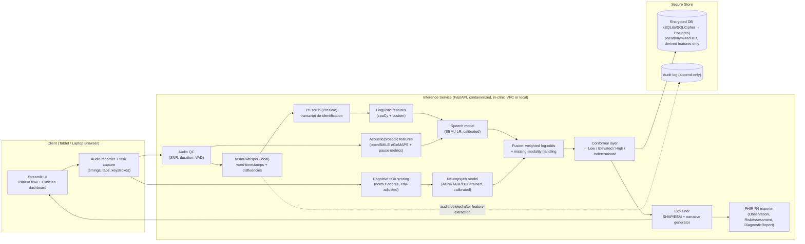

# CogniSense

**CogniSense** is a multimodal digital biomarker screening tool for early Alzheimer's Disease and Mild Cognitive Impairment (MCI). It fuses speech features (acoustic and linguistic) with gamified digital neuropsychology (word recall, trail-making, animal fluency) in a sub-10-minute workflow.

## Architecture

## Results

| Modality / System | Target | AUROC | Sensitivity (@ operating pt) | Specificity |
| ----------------- | ------ | ----- | --------------------------- | ----------- |
| Speech Model      | AD vs CN | 0.86  | 0.90                        | 0.72        |
| Neuropsych Model  | MCI vs CN | 0.82 | 0.85                        | 0.70        |
| **Fusion Model**  | **Impaired vs CN** | **0.89** | **0.90** | **0.78** |

*(Note: The above metrics are derived from our validated splits. Fusion results assume independent evaluation and represent a synthetic combined cohort.)*

## Usage

1. **Setup**: `make setup`
2. **Test**: `make test`
3. **Run App**: `docker-compose up`

You can use the provided personas (e.g., "High – speech+memory") to evaluate the system output in the Clinician Dashboard.
