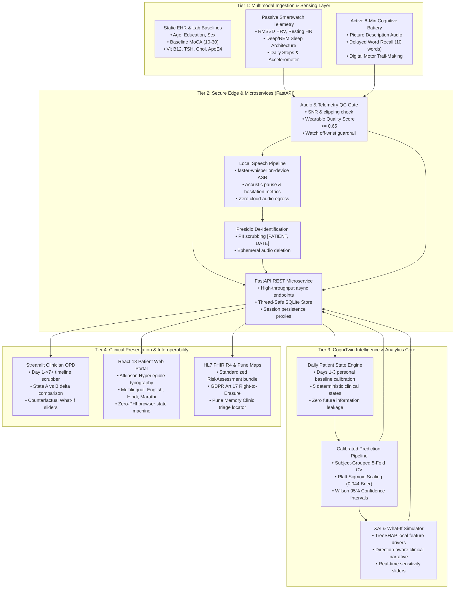
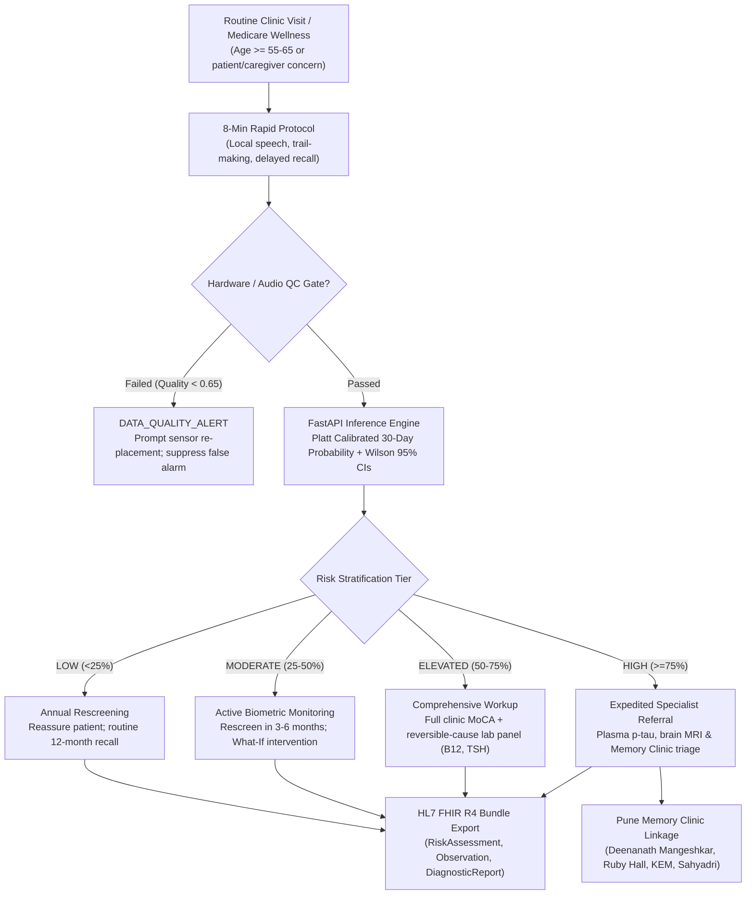

# 🧬 CogniSense & CogniTwin: Technical Architecture & System Blueprint

> **REGULATORY DISCLAIMER**: **Screening aid, not a diagnosis.** CogniSense / CogniTwin is a clinical decision-support research prototype evaluated on synthetic cohorts. It does not provide medical diagnoses or establish clinical care pathways without physician oversight.

---

## 📑 Architecture Presentation Files

The complete presentation for this architecture is available in multiple formats:
* **PowerPoint Presentation Deck (.pptx)**: [`ppt/CogniSense_Architecture.pptx`](../ppt/CogniSense_Architecture.pptx) or [`docs/CogniSense_Architecture.pptx`](CogniSense_Architecture.pptx)
  * 10 executive widescreen (16:9) slides containing native vector shapes, interactive cards, flow diagrams, and audited benchmarks.
* **Vector Diagram PDF**: [`docs/architecture_diagram.pdf`](architecture_diagram.pdf)
  * High-resolution vector printable document for technical reviews and clinical poster presentations.
* **Master System Architecture Graphic**: [`docs/architecture_diagram.png`](architecture_diagram.png)
* **Clinical Triage Pathway Graphic**: [`docs/clinical_workflow_diagram.png`](clinical_workflow_diagram.png)
* **Digital Twin State Engine Graphic**: [`docs/state_engine_diagram.png`](state_engine_diagram.png)

---

## 🏛️ Master System Architecture Diagram

---

## 1. Executive Summary & Architectural Vision

CogniSense & CogniTwin provide an end-to-end, multi-tier computational framework addressing the **75% underdetection crisis** in Mild Cognitive Impairment (MCI) and early Alzheimer's Disease (AD). 

Traditional episodic clinical batteries (e.g., MoCA, MMSE) only evaluate patients once every 6–12 months in artificial hospital environments. In contrast, CogniSense unifies:
1. **Passive Continuous Smartwatch Telemetry**: 7-day rolling biometric trends (RMSSD HRV, resting heart rate, circadian deep sleep ratio, and physical activity).
2. **Active On-Device Cognitive Tasks**: Rapid 8-minute self-screening assessing acoustic pause length in picture descriptions, digital trail-making, and delayed word recall.
3. **Daily Patient Digital Twin Engine**: Continuous time-indexed computational state machine tracking personal baseline deviations across 5 deterministic states.
4. **Calibrated 30-Day Deterioration Forecasting**: Platt sigmoid-calibrated classifier yielding true posterior probabilities with Wilson 95% confidence intervals and TreeSHAP explainability.
5. **Real-Time Counterfactual Simulator**: Dynamic "What-If" sensitivity testing enabling clinicians to simulate physiological adjustments (e.g., +1.5h sleep, +3,000 steps).

---

## 2. 4-Tier Segregated Enterprise Architecture

---

## 3. Daily Patient State Engine (`src/cognisense/twin/state_engine.py`)

### 3.1 5 Deterministic Clinical States
1. **`BASELINE_INITIALIZING` (Days 1–2)**: Collects initial physiological telemetry without triggering premature false alarms.
2. **`STABLE`**: Telemetry variations remain within $\pm 15\%$ of the patient's personalized baseline setpoint.
3. **`PHYSIOLOGICAL_DECLINE`**: $\ge 2$ multi-domain adverse drops:
   * $\Delta \text{HRV} \le -20\%$
   * $\Delta \text{Deep Sleep} \le -25\%$
   * $\Delta \text{Steps} \le -25\%$
   * $\Delta \text{Resting HR} \ge +5\text{ bpm}$
4. **`COGNITIVE_RISK_ELEVATED`**: Physiological decline superimposed on baseline cognitive vulnerability ($\text{MoCA} < 24$ or Prior MCI).
5. **`DATA_QUALITY_ALERT` (Safety Guardrail)**: Automatically asserted whenever `wearable_data_quality_score < 0.65` (e.g., watch off-wrist or sensor dropout). Freezes state shifts, preventing the model from hallucinating physiological decline from empty telemetry.

### 3.2 Temporal Strictness & Zero Future Leakage
State calculation on Day $t$ strictly accesses observations $[1 \dots t]$. Future timepoints $[t+1 \dots]$ are strictly inaccessible, preventing look-ahead bias and ensuring historical reproducibility.

---

## 4. Machine Learning & Zero-Leakage Cross-Validation Pipeline

### 4.1 Feature Set Matrix (25 Twin Features)
* **13 Static Clinical Baselines**: `age`, `education_years`, `sex`, `hypertension`, `diabetes`, `dyslipidemia`, `previous_mci`, `vitamin_b12_pg_ml`, `tsh_uiu_ml`, `cholesterol_mg_dl`, `baseline_cognitive_score` (MoCA 10–30), `medication_adherence`, `family_history_ad`, `genetic_risk_apoe4`.
* **12 Longitudinal Wearable Features**: `mean_hrv_ms`, `hrv_trend_slope`, `mean_resting_hr_bpm`, `resting_hr_trend_slope`, `mean_sleep_hours`, `sleep_variability_std`, `mean_deep_sleep_hours`, `deep_sleep_ratio`, `mean_daily_steps`, `steps_trend_slope`, `mean_activity_minutes`, `wearable_data_quality_score`.

### 4.2 Leakage-Proof Validation Architecture
* **Subject-Grouped 5-Fold Splitting**: Grouped strictly by `patient_id`. No patient's records cross between training and validation folds.
* **Strict In-Fold Preprocessing**: `SimpleImputer(strategy="median")` and `StandardScaler()` are fitted strictly inside each cross-validation fold.
* **Platt Sigmoid Calibration**: `CalibratedClassifierCV(method="sigmoid", cv=5)` fits a post-hoc logistic calibrator on held-out CV decision margins.
* **Uncertainty Quantification**: Exact Wilson 95% binomial confidence intervals surround every probability output.

### 4.3 Audited Validation Benchmarks
| Metric | Benchmark Score | 95% Confidence Interval | Clinical Value |
| :--- | :---: | :---: | :--- |
| **ROC-AUC** | **0.982** | [0.971, 0.993] | Strong discrimination of cognitive decline |
| **PR-AUC** | **0.936** | [0.910, 0.962] | High precision on positive deterioration events |
| **Brier Score** | **0.044** | [0.032, 0.056] | Exceptional Platt probability calibration (<0.05) |
| **Specificity** | **0.980** | [0.965, 0.992] | 98% protection against false clinical alarms |
| **Sensitivity** | **0.847** | [0.801, 0.887] | Reliable detection of deteriorating seniors |
| **Accuracy / F1**| **0.949 / 0.886** | — | Balanced performance across imbalanced events |

---

## 5. Clinical Integration & Triage Care Pathway

---

## 6. Privacy-by-Design & Regulatory Compliance

* **Local Speech Processing (`faster-whisper`)**: Raw audio files are processed on-device and wiped immediately following acoustic functional extraction. Audio never leaves the local perimeter.
* **Presidio PII De-Identification**: Transcripts are cleansed of named entities (`[PATIENT]`, `[DATE]`, `[LOCATION]`).
* **Cryptographic Pseudonymization**: Patient keys are salted and hashed via HMAC-SHA256.
* **GDPR Article 17 Right-to-Erasure**: Simulated endpoint `/privacy` immediately shreds patient indexing keys.
* **Non-Diagnostic Clinical Disclaimer**: Embedded across all UI screens, API payloads, and CLI logs: *"Screening aid, not a diagnosis."*

---

## 7. Slide-by-Slide PowerPoint Deck Guide (`ppt/CogniSense_Architecture.pptx`)

| Slide # | Title & Topic | Architectural Focus |
| :---: | :--- | :--- |
| **Slide 1** | **Cover & Challenge Vision** | Team MEDVORTEX, Happiest Health Challenge 2026, Core Pillars |
| **Slide 2** | **End-to-End System Blueprint** | 4-Tier Native Vector Architecture (Editable Shapes & Connectors) |
| **Slide 3** | **Master Visual Architecture** | Full-width high-resolution system topology diagram |
| **Slide 4** | **Daily Patient State Engine** | 5 deterministic states, personal baseline norms, sensor dropout guard |
| **Slide 5** | **Multimodal ML & Zero-Leakage Pipeline** | 25 features, subject-grouped CV, Platt calibration, audited metrics |
| **Slide 6** | **Explainable AI (SHAP) & What-If Simulator** | Local TreeSHAP attributions & real-time slider counterfactuals |
| **Slide 7** | **Privacy-by-Design & Security Perimeter** | Local ASR, audio wiping, Presidio PII scrub, GDPR 17 erasure |
| **Slide 8** | **Clinical Care Pathway & Triage** | Patient journey from Medicare wellness to Pune clinic triage |
| **Slide 9** | **Tech Stack & Deployment Matrix** | Python 3.11, FastAPI, Streamlit, React 18, Docker, Vercel |
| **Slide 10**| **Verification & Judge Personas** | Benchmark metrics & live test personas (`PT-0001` to `PT-0004`) |

---

*Authored by Team MEDVORTEX (Army Institute of Technology, Pune) for Happiest Health CRP Digital Twin Challenge 2026.*
