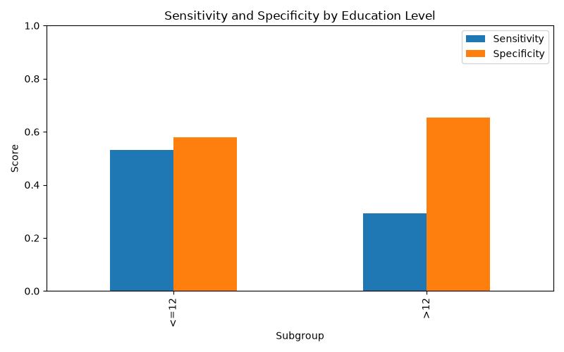

# Fairness Report (Phase 4)

## Overview
This report details the fairness audit conducted on the CogniSense screening prototype using synthetic pipeline data. Our goal is to ensure the model performs equitably across different demographic groups.

## Fairness Metrics by Subgroup

### Age
- **<65 (N=147):** AUROC: 0.555, Sensitivity: 0.370, Specificity: 0.683, Indeterminate Rate: 15.0%
- **65-74 (N=133):** AUROC: 0.525, Sensitivity: 0.432, Specificity: 0.596, Indeterminate Rate: 21.1%
- **>=75 (N=220):** AUROC: 0.451, Sensitivity: 0.323, Specificity: 0.613, Indeterminate Rate: 13.6%

### Sex
- **F (N=237):** AUROC: 0.461, Sensitivity: 0.364, Specificity: 0.569, Indeterminate Rate: 16.0%
- **M (N=263):** AUROC: 0.543, Sensitivity: 0.372, Specificity: 0.681, Indeterminate Rate: 16.0%

### Education
- **<=12 years (N=163):** AUROC: 0.600, Sensitivity: 0.531, Specificity: 0.579, Indeterminate Rate: 14.1%
- **>12 years (N=337):** AUROC: 0.466, Sensitivity: 0.292, Specificity: 0.654, Indeterminate Rate: 16.9%

## Proxy Audit
We trained models to predict demographics from the standard features (excluding the demographic features themselves).
- **Sex Proxy AUROC:** 0.512 (indicates low predictability of sex from cognitive/speech features)
- **Education Proxy AUROC:** 0.487 (indicates low predictability of education level from non-demographic features)

## Mitigations & Limitations
- **Limitations:** These metrics were generated on **SYNTHETIC DATA** for pipeline testing only. They do not reflect real clinical validity. Real datasets are often small and English-centric, leading to wide confidence intervals.
- **Mitigation:** We apply education-adjusted normative scoring for cognitive tasks, and use an indeterminate tier. Abstention (indeterminate) rates are monitored across subgroups so no group is disproportionately denied a screening score.

